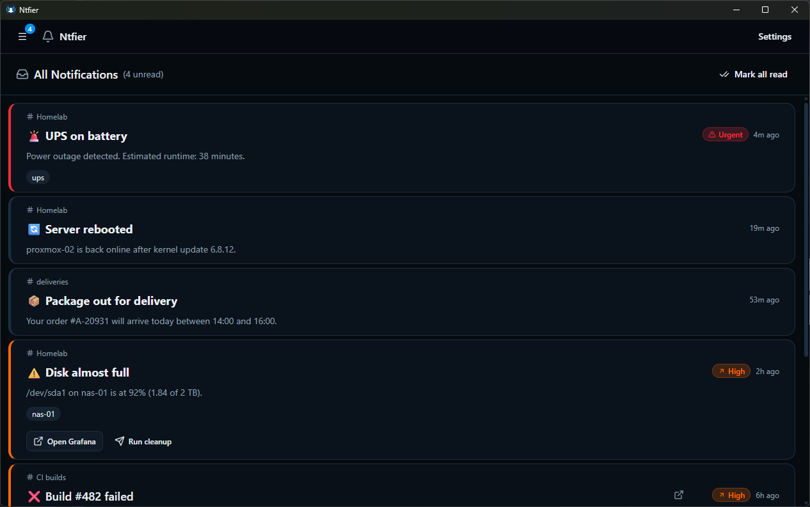
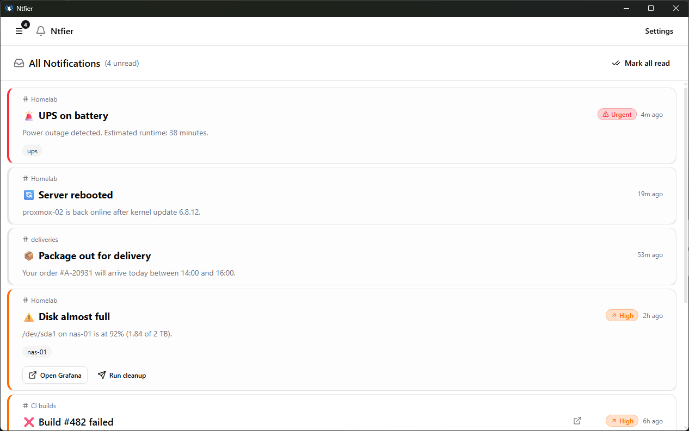
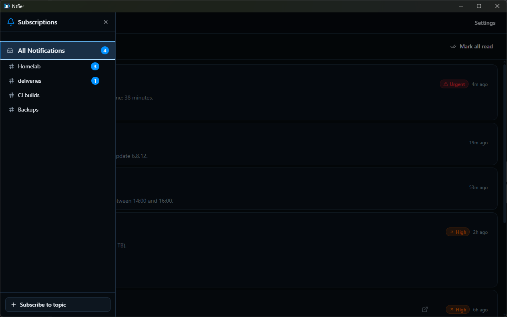
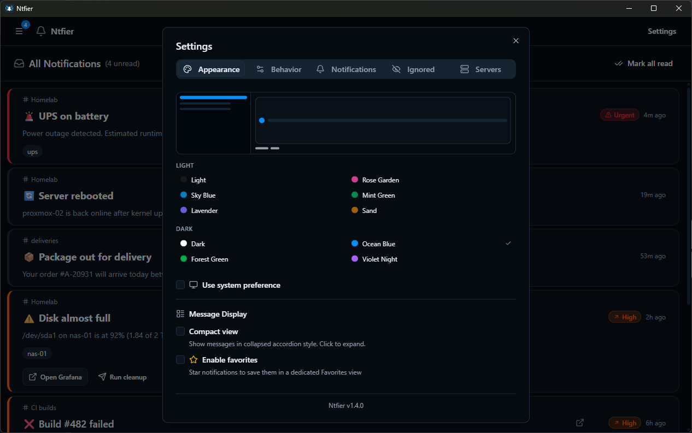

<p align="center">
  
</p>

<h1 align="center">Ntfier</h1>

<p align="center">
  A modern desktop notification client for <a href="https://ntfy.sh">ntfy</a>
</p>

## Features

- Real-time notifications via WebSocket
- Connect to multiple ntfy servers at once
- Subscribe to and manage multiple topics
- System tray with background notifications
- Auto-start on login
- Notification history with search
- Markdown rendering in notifications
- Image previews and attachment downloads
- Priority level indicators
- Dark/light themes (follows system preference)
- Auto-updates
- Cross-platform via Tauri (Windows now, macOS/Linux planned)

## Screenshots

| Dark theme | Light theme |
|---|---|
|  |  |
| **Subscriptions** | **Settings** |
|  |  |

## Installation

Download the latest release from the [Releases](https://github.com/kbzowski/ntfier/releases) page.

## Upgrading

### v1.0.0 Breaking Changes

**Database migration required:** Version 1.0.0 switches from rusqlite to Diesel ORM with a new database schema. The old database is **not compatible** with this version.

**Before upgrading, you must delete the old database file:**

```
%APPDATA%\com.ntfier.app\ntfier.db
```

> **Note:** This will delete all your subscriptions and notification history. You will need to re-add your subscriptions after upgrading.

## Requirements

This project uses [proto](https://moonrepo.dev/proto) for toolchain management:
Install proto and run `proto install` to install the required toolchains.

## Development

```bash
pnpm install
pnpm dev
```

## Build

```bash
pnpm build
```

Build outputs are located in `src-tauri/target/release/bundle/`.

## Releasing

Releases are built and signed on the author's PC, not in CI. Requirements:

- the Certum token plugged in, with proCertum CardManager in minidriver mode
- PowerShell 7 (`pwsh`) and `signtool.exe` from the Windows SDK
- the updater key at `%USERPROFILE%\.tauri\ntfier.key`
- `gh auth login`

Bump the version in `src-tauri/tauri.conf.json` in its own commit, push `main`, then:

```bash
pnpm release 1.5.0 [--prerelease] [--dry-run]
```

The script asks for the updater key password and the token PIN (once), builds and verifies the signed installers, then pushes the tag and creates a draft release. `--dry-run` stops before the tag.

## Project Structure

```
ntfy-desktop/
├── ui/           # React frontend (TanStack Router, Tailwind CSS)
└── src-tauri/    # Rust backend (Tauri 2)
```

## Linting & Formatting

### UI
```bash
pnpm ui:lint
pnpm --filter ui format
pnpm --filter ui check
```

### Backend (src-tauri)
```bash
cd src-tauri
cargo fmt
cargo clippy
```

## License

MIT
